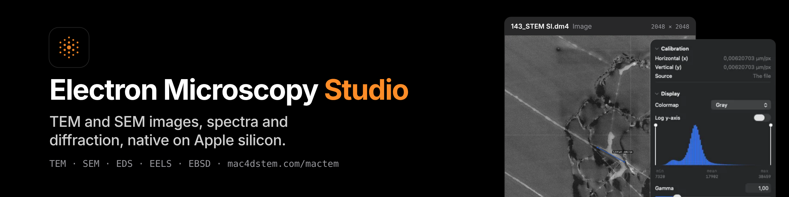

# Electron Microscopy Studio

TEM and SEM images, EDS and EELS spectrum images, electron diffraction and EBSD, analysed natively on the Mac.

Electron Microscopy Studio is the companion to [4DSTEM Studio](https://github.com/EMSuite/4DSTEM-Studio). Both are free, open source and built for
Apple silicon.

**Documentation:** [mac4dstem.com/docs/electron-microscopy-studio](https://mac4dstem.com/docs/electron-microscopy-studio/), with the
[tutorials](https://mac4dstem.com/docs/tasks/) and the [example data](https://mac4dstem.com/docs/data/). In the app, Help opens them
(⌘? for the documentation).

## Download

Get the signed and notarised DMG from the [latest release](https://github.com/EMSuite/Electron-Microscopy-Studio/releases/latest). It needs
macOS 26 or later on an Apple silicon Mac. Release 2.1.1 has everything below, the SEM and EBSD rooms included.

From 2.1 the download checks for updates itself (Microscopy Studio > Check for Updates…, and a daily check you can turn off
in Settings); the App Store version updates through the store.

Up to 2.1.0 the download was called macEM (and up to 1.3 macTEM). A copy that updates itself keeps its old file name in
Applications and shows the new name everywhere else; rename it in the Finder if you like. A fresh download is
Electron Microscopy Studio.app. Your settings, recent files, the folders you allowed and your `.mactem.h5` session files
carry over either way.

## What it does

Open a file and work through the sidebar. It lists five workspaces, Imaging, Spectroscopy, Diffraction, EBSD and Results,
and under the one in front its rooms. What the file holds decides the room it opens in. Electron Microscopy Studio reads:

- **TEM**: DigitalMicrograph (.dm3, .dm4), Velox (.emd), TIA (.ser with its .emi), TIFF and MRC images; EDS spectrum images from Velox and GMS,
  EELS spectrum images from GMS, TIA spectra and spectrum images in the EDS or EELS room, and single .msa spectra.
- **HyperSpy**: a .hspy file's images, EELS and EDS spectrum images and spectra, each in its room (several in one file
  open together, as a Velox file's do), read with FormatoKit's reader.
- **Pictures**: a pattern or image saved as PNG or JPEG (from a paper or a camera export) opens as a picture, not counts;
  its scale is typed or fitted to a ring of a known phase.
- **SEM images**: TIFF from Thermo Fisher (FEI), Zeiss and Tescan, read with the microscope's settings, and JEOL .img
  and .map files.
- **SEM-EDS**: Bruker .bcf and .spx, EDAX .spd, .lsd and .spc, JEOL .pts, .eds and .asw, and an SEM spectrum in a
  HyperSpy .hspy file.
- **EBSD and TKD patterns**: h5ebsd from kikuchipy, Bruker, EDAX and Oxford Instruments (.h5oina), EDAX .up1 and .up2,
  Oxford .ebsp and NORDIF Pattern.dat.
- **Orientation maps**: .ang, .ctf, Oxford .h5oina saved without patterns (AZtec's map export), and .h5 maps from orix, Bruker
  Esprit and EDAX OIM saved without patterns, and EMsoft's dictionary indexing.

In Finder, a .dm3, .dm4, .mrc, .emd or .ser file shows its image as its icon, and the space bar shows a card with the image, its
scale bar and what the file's header says (Quick Look), without opening the app. A .ser file shows its image without its .emi
(no calibration then), and an .emd that is not a Velox file shows the header card without an image.

TKD patterns are read and indexed as EBSD patterns are; no TKD dataset has been checked in the app yet.

Some files are read together with a file of the same name beside them, so keep them in one folder: an EDAX .spd or
.lsd with its .spc, an EDAX .up1 or .up2 with its .ang, and an Oxford .ebsp with its .ctf. A NORDIF Pattern.dat is read
with the Setting.txt in its folder: the first time, the app asks for that folder. A JEOL .asw project needs the files it
names; the sandboxed app is not given those yet, so it may not open.

No file at hand? Help > Open Demo Data opens generated TEM documents and three public SEM datasets.

The rooms:

- **Image**: calibration, colormap, contrast and gamma; distances, angles, line profiles and particles (in the whole image or a region); image stacks.
  Your marks are saved in a session file next to the image. An SEM TIFF shows the microscope's settings, and a Thermo
  Fisher or Tescan databar can be hidden or shown under the picture (Settings > Images).
- **FFT**: the transform of the image or a region, spots and their d-spacings, the radial profile, a masked inverse,
  ABSF and Wiener filters, and strain maps by geometric phase analysis (checked on planted fields only). The transform
  exports as a PNG, or as a PDF or SVG figure with its rings and labels as vectors.
- **EDS**: Velox and GMS spectrum images, and SEM-EDS maps, line scans and spectra. Pick elements from the periodic
  table or let Auto ID suggest them, then get net, wt%, at% and thickness maps, regions, and the Cliff-Lorimer
  composition.
- **EELS**: Dual-EELS spectrum images. Align the zero-loss peak, map t/λ, pick edges from the periodic table, and fit
  their intensities and at%. In both rooms the spectrum and the maps export as PDF or SVG figures for a paper, the
  spectrum as one path and every label as live text.
- **Diffraction**: calibrate on a ring of a standard, then index rings and spots and read their d-spacings; type a zone axis to
  see the crystal's simulated spots, with their hkl, over the pattern (with the spots double diffraction adds, and an excitation
  error to set), or press Index to find the spots and the crystal's full
  orientation (the found spots stay as marks to remove or add to; clicked spots give the zone axis); step through tied solutions,
  flip 180°, fit the scale or hold it, and drag the simulated spots to tilt them (⌥ drag turns them; ⌥ and an arrow tilt by a step); the Spots table lists each
  spot's hkl, R (in mm with the camera's pixel pitch), expected d and misfit, and exports as a Spots CSV.
  Phases come from your library: Add Phase… finds one on the Materials Project or opens a CIF, and a phase added once works offline.
  Find Phases ranks your phases against the measured rings or spots, and with the sample's elements (typed or taken from the
  EDS room) also the Materials Project's most stable phases of every combination of them, saying how many came from each.
  The crystal pane beside the pattern appears with the simulated spots and shows the phase in 3D down the same beam; turning it
  turns the spots, and View > Hide Crystal hides it.
  File > New Simulation (⇧⌘N) opens the simulated spots with no measured pattern under them: its Microscope section sets the
  voltage and camera length, its Orientation section the zone axis and turn, and its Spots table lists each spot's hkl, R in px and
  in mm (R = λ L |g|), q and d, and exports as a Spots CSV. ⌘S (File > Save Simulation) saves the document as a small `.emsim`
  session file holding its phase and settings; opening that file brings back the same pattern and spot list.
  Its Specimen section builds the phase along that axis into the slab a simulation computes, with its box, atoms and strain,
  and Show HRTEM Image opens the slab's HRTEM image in the Image room, with Defocus and Thickness that redraw it live, the Uncorrected and Cs Corrected optics, an objective aperture, the transfer function strip, a defocus by thickness table that exports as a PNG, and frozen phonons (σ per element, Simulate, Stop and Continue, with the run's plan, progress and convergence); the crystal pane shows the slab with its box and size, and Atom columns rings the slab's projected columns on the image, and Place Beside, which shows it beside an open measured image or inset in it at the measured image's nanometres per pixel, one picture that exports with one scale bar; the measured image is kept as a link to its file (name, size and fingerprint, never a path), found again where it moved, or named as not connected with Locate…. Export abTEM Script… writes the image's run as a Python script for abTEM 1.0.10, to rerun or change it there. The Specimen section's Source also takes an atom model built elsewhere (CIF, XYZ or POSCAR, up to a million atoms, from atomsk, ASE or VASP), with the beam along its c, a or b.
  Kinematic or Dynamical switches the spots to the multislice's beams at a thickness slider's thickness, with the reflections
  the crystal forbids as open rings and each spot's dynamical intensity in the Spots table. Convergent turns the beam into a
  probe: Show CBED Pattern opens its convergent-beam pattern in the Diffraction room, the semiangle set by Fit Discs to keep the
  discs apart, a pattern stored about every 2 nm to the largest thickness for the thickness slider, and the box the angular step
  needs named before the run. Measure Thickness reads a two-beam CBED pattern's diffracted disc and fits its fringes for the
  specimen thickness (Kelly et al. 1975), with the profile, the fitted curve and Use in Simulation.
  Show STEM Image opens the slab's STEM image in the Image room: Simulate scans the probe over one projected unit, the image
  filling as it is computed, with or without frozen phonons, and Stop and Continue keep what is done; BF, ABF, ADF and HAADF are
  bands on the scattered intensity against angle, moved after the run with no new run, and the scan step starts at Nyquist.
- **Patterns**: the EBSD or TKD scan beside the live pattern, with mean intensity, virtual BSE, image quality and
  average dot product maps. Remove the static and dynamic backgrounds, rescale or normalise, equalise, filter, bin,
  average neighbouring patterns and denoise with NLPAR. Draw the Kikuchi bands of the file's stored orientations over
  the pattern. The file stays unchanged.
- **Indexing**: Hough indexing, or dictionary indexing against an EMsoft master pattern, for one or several phases from
  the file, a preset or a CIF. Read each point's solution, compare two results side by side, and export the map as .ang
  or .ctf.
- **Maps**: IPF and phase maps with their colour keys; grains, and grain and phase boundaries over the map; grain size
  (mean and area-weighted ECD, mean lineal intercept, ASTM E112); KAM, GOS and GND; Schmid factors and slip traces; pole
  figures, ODF sections and histograms. A map comes from an .ang, .ctf or map-only .h5oina file, from a pattern file that
  carries one, or from the Indexing room. The map exports as a PNG, or as a PDF or SVG figure for a paper: the boundaries
  as lines, a vector scale bar and the key as live text.
- **Results**: every measurement of a file in one table, exported as CSV. The SEM results have a table of their own and
  a session report, as PDF or Markdown.
- **Methods**: every export carries a record of how its numbers were made (the source by fingerprint, each step and setting,
  the app and kit versions). File > Export Methods Record… saves the room's record as JSON, and Edit > Copy Methods
  Paragraph copies it as a paragraph for a paper's methods section.
- **HyperSpy files**: File > Export HyperSpy File… writes the Image room's image, the Diffraction room's pattern or the
  EELS room's spectrum image as a .hspy that `hs.load` opens (Signal2D, pyxem's ElectronDiffraction2D in Å⁻¹, or exspy's
  EELSSpectrum), at its stored bit depth, with the methods record in its metadata. A cube shows its progress and can be stopped.

## Agents

An AI agent on the same Mac (Claude, Codex, a script) can look at what a window shows, and with your leave work a room,
through the agent door: Settings > Agents, off by default. What it can reach is in [`docs/agent-door.md`](docs/agent-door.md).

## Privacy

No telemetry, no account. The app connects to one other service on its own: the
[Materials Project](https://materialsproject.org), and only when you search for a phase or add one. It sends the
elements or formula you type (or that Find Phases takes from the EDS room when you press Search), or the entry's id, and your own API key if you saved one in Settings > Materials Project
(the key is optional and stays in your login keychain). A phase once added works offline. The website download also
fetches its update feed. Details are in [`SECURITY.md`](SECURITY.md).

## Where the numbers come from

The TEM methods compute with the suite's Swift kits, each checked against the Python package it ports, within that
package's own tolerance: [FormatoKit](https://github.com/EMSuite/FormatoKit) (file readers),
[ImagoKit](https://github.com/EMSuite/ImagoKit) (FFT and image maths),
[DiffractoKit](https://github.com/EMSuite/DiffractoKit) (crystallography),
[SpectroKit](https://github.com/EMSuite/SpectroKit) (EDS and EELS) and
[SimulatoKit](https://github.com/EMSuite/SimulatoKit) (the simulation's slab, multislice and HRTEM image, after abTEM). The SEM
methods are ported into the app itself and
checked the same way, against pinned versions of [kikuchipy](https://github.com/pyxem/kikuchipy) (pattern files,
processing and dictionary indexing), [PyEBSDIndex](https://github.com/USNavalResearchLaboratory/PyEBSDIndex) (Hough
indexing and NLPAR), [orix](https://github.com/pyxem/orix) (orientations, colour keys, texture, and .ang and .ctf
files), [DefDAP](https://github.com/MechMicroMan/DefDAP) (grains, GOS and slip; KAM and GND with the departures listed
in `docs/parity.md`), [eXSpy](https://github.com/hyperspy/exspy) (SEM-EDS lines),
[RosettaSciIO](https://github.com/hyperspy/rosettasciio) (the Bruker, EDAX and JEOL SEM-EDS files, and the Thermo Fisher
and Zeiss TIFF settings) and [NexusLIMS](https://github.com/datasophos/NexusLIMS) (the Tescan TIFF settings). The
Kikuchi bands are checked against kikuchipy and [diffsims](https://github.com/pyxem/diffsims). Which SEM function is
checked against what, and to which tolerance, is in [`docs/parity.md`](docs/parity.md). Every result names the method
that made it.

## Building it yourself

You need Xcode 27 or Xcode 26.6 on an Apple silicon Mac with macOS 26 or later. Open `macTEM.xcodeproj`, pick the `macTEM` scheme and press ⌘R. The first build fetches the kits at
the versions in `Package.resolved`. The tests run with `tools/run-tests.sh unit`. How the code is organised is in
[`docs/architecture.md`](docs/architecture.md).

## Problems and ideas

Please open an issue. Bug reports with the file type and what you expected help most. How to contribute is in
[`CONTRIBUTING.md`](CONTRIBUTING.md); security reports go through [`SECURITY.md`](SECURITY.md).

## Citing

If you use Electron Microscopy Studio in published work, please cite it and the Python packages whose methods it follows. All are in
[`CITATION.cff`](CITATION.cff).

## Licence

GPL-3.0-only ([`LICENSE`](LICENSE)). Third-party notices are in [`NOTICE`](NOTICE).
